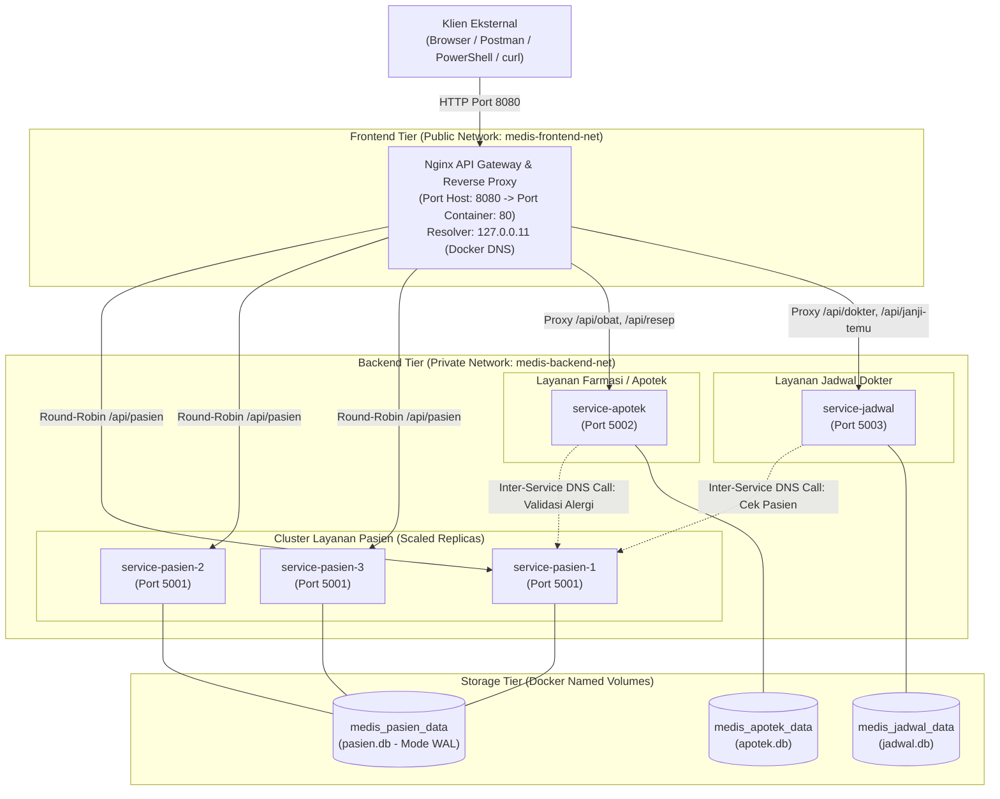

# Medis-Cloud: Sistem Informasi Medis Rumah Sakit

[](https://www.docker.com/)
[](https://docs.docker.com/compose/)
[](https://nginx.org/)
[](https://www.python.org/)
[](https://www.sqlite.org/)

**Medis-Cloud** adalah platform sistem informasi rumah sakit berbasis arsitektur **Cloud Microservices**, **API Gateway & Load Balancer (Nginx)**, **Disaster Recovery**, serta **Simulasi Elasticity (Horizontal Auto-Scaling)** menggunakan kontainer Docker.

Proyek ini dikembangkan oleh **Kelompok 4** untuk mata kuliah **Cloud Computing** di Program Studi Sistem Informasi / Sains dan Teknologi, **UIN Sunan Ampel Surabaya**.

---

## 1. Arsitektur Sistem

Sistem mengadopsi prinsip **Domain-Driven Design (DDD)** dengan pola *Database-per-Service* dan arsitektur jaringan bertingkat (*Multi-Tier Security Network*).



---

## 2. Fitur Utama Sistem

### A. API Gateway Tunggal & Reverse Proxy (Nginx)
* Seluruh permintaan klien hanya dilayani melalui satu gerbang tunggal pada **port 8080**.
* Port microservices backend (5001, 5002, 5003) diisolasi di jaringan internal privat dan tidak diekspos ke host publik.

### B. Dynamic DNS Discovery & Round-Robin Load Balancing
* Nginx dikonfigurasi dengan DNS internal Docker Engine:
  ```nginx
  resolver 127.0.0.11 valid=2s ipv6=off;
  ```
* Nginx membagi beban request secara otomatis ke seluruh kontainer replika yang aktif mengikuti algoritma **Round-Robin**.
* Setiap respon HTTP menyertakan header pelacak kontainer: `X-Served-By`.

### C. Elasticity (Horizontal Scaling)
* Layanan rekam medis pasien dapat diskalakan secara instan tanpa menimbulkan *downtime*:
  ```powershell
  docker compose up -d --scale service-pasien=3
  ```

### D. Disaster Recovery & Data Persistence
* Database rekam medis disimpan pada **Docker Named Volume** (`medis_pasien_data`).
* Mengaktifkan mode **SQLite WAL (Write-Ahead Logging)** sehingga aman dibaca secara simultan oleh banyak replika kontainer tanpa terjadi *database locking*.
* Pemulihan data cadangan teruji dengan **RTO (Recovery Time Objective) < 1 detik**.

### E. Fault Isolation & Cross-Service Communication
* **Pengecekan Alergi Obat Lintas Servis**: Saat dokter menerbitkan resep di Layanan Apotek, sistem otomatis memanggil Layanan Pasien via DNS `http://service-pasien:5001` untuk mengecek kontraindikasi riwayat alergi antibiotik pasien.
* **Fault Isolation**: Jika Layanan Pasien dimatikan, Layanan Apotek dan Layanan Jadwal Dokter tetap beroperasi normal melayani data katalog lokal tanpa mengalami kegagalan beruntun (*cascading failure*).

---

## 3. Struktur Direktori

```text
medis-cloud/
├── docker-compose.yml          # Berkas orkestrasi seluruh layanan medis
├── demo.bat                    # Launcher 1-klik master demo (Bypass ExecutionPolicy)
├── demo.ps1                    # Menu interaktif pusat kendali demo
├── .gitignore                  # Berkas filter git
├── README.md                   # Dokumentasi arsitektur dan panduan proyek
├── infra/
│   └── nginx/
│       └── nginx.conf          # Konfigurasi API Gateway & Load Balancer Nginx
├── services/
│   ├── pasien/                 # Microservice Data Pasien & Rekam Medis (Port 5001)
│   │   ├── app.py
│   │   ├── Dockerfile
│   │   └── requirements.txt
│   ├── apotek/                 # Microservice Farmasi, Obat & Resep (Port 5002)
│   │   ├── app.py
│   │   ├── Dockerfile
│   │   └── requirements.txt
│   └── jadwal-dokter/          # Microservice Jadwal Dokter & Janji Temu (Port 5003)
│       ├── app.py
│       ├── Dockerfile
│       └── requirements.txt
├── monolit/                    # Baseline aplikasi monolitik awal (Port 5000)
│   ├── app.py
│   ├── Dockerfile
│   └── requirements.txt
├── lab1/                       # Modul pengujian dasar kontainer & volume (Port 8000)
│   ├── app.py
│   └── Dockerfile
├── backup/                     # Arsip snapshot disaster recovery volume
└── scripts/                    # Skrip otomasi pengujian dan simulasi
    ├── demo-p1.ps1             # Otomasi demo Pertemuan 1 (Dasar Docker & DR)
    ├── demo-p2.ps1             # Otomasi demo Pertemuan 2 (Microservices & DDD)
    ├── demo-p3.ps1             # Otomasi demo Pertemuan 3 (Compose & Elasticity)
    ├── run-compose.ps1         # Menjalankan seluruh stack compose
    ├── scale-pasien.ps1        # Penskalaan horizontal service-pasien
    ├── test-loadbalance.ps1    # Pengujian distribusi beban Round-Robin Nginx
    └── stop-compose.ps1        # Penghentian seluruh kontainer
```

---

## 4. Panduan Menjalankan Sistem

### Prasyarat
* **Docker Desktop** (Engine running / Linux containers)
* **Windows PowerShell** atau **WSL (Ubuntu Linux)**

---

### A. Menjalankan Seluruh Sistem (Single-Command Up)

```bash
# Clone repositori
git clone https://github.com/Daff77/medis-cloud.git
cd medis-cloud

# Jalankan seluruh stack kontainer di latar belakang
docker compose up -d
```

Verifikasi seluruh kontainer berstatus **Up (healthy)**:
```bash
docker compose ps
```

---

### B. Menjalankan Master Demo Interaktif

Tersedia launcher praktis yang memandu demonstrasi fitur:
```cmd
# Di Windows PowerShell / Command Prompt:
.\demo.bat
```

---

### C. Simulasi Elasticity (Scaling 3 Replika Pasien)

Tambahkan instance kontainer Layanan Pasien:
```bash
docker compose up -d --scale service-pasien=3
```

Periksa 3 replika aktif:
```bash
docker compose ps service-pasien
```

---

### D. Pengujian Load Balancing Round-Robin

Kirimkan pengujian beban berturut-turut untuk melihat rotasi ID kontainer pada header `X-Served-By`:
```powershell
.\scripts\test-loadbalance.ps1
```

---

### E. Menghentikan Sistem

```bash
docker compose down
```
*(Catatan: Perintah di atas mempertahankan data rekam medis di volume host. Jika ingin menghapus volume data secara bersih, tambahkan flag `-v`: `docker compose down -v`).*

---

## 5. Dokumentasi REST API

Semua endpoint diakses melalui gerbang Nginx di port **8080**:

| Method | Endpoint | Deskripsi | Layanan Backend |
| :--- | :--- | :--- | :--- |
| `GET` | `/` | Informasi status API Gateway | `nginx-gateway` |
| `GET` | `/health` | Healthcheck kesiapan sistem | `nginx-gateway` |
| `GET` | `/api/pasien` | Mengambil seluruh data rekam medis pasien | `service-pasien` |
| `POST`| `/api/pasien` | Mendaftarkan pasien rekam medis baru | `service-pasien` |
| `GET` | `/api/obat` | Menampilkan katalog stok obat apotek | `service-apotek` |
| `POST`| `/api/resep` | Memproses resep (validasi alergi obat) | `service-apotek` |
| `GET` | `/api/dokter` | Menampilkan jadwal dokter & kuota poli | `service-jadwal` |
| `POST`| `/api/janji-temu` | Booking pendaftaran antrean periksa | `service-jadwal` |

### Contoh Pengujian Endpoint (PowerShell)

**1. Mengambil Daftar Pasien:**
```powershell
Invoke-RestMethod -Uri "http://localhost:8080/api/pasien" | ConvertTo-Json
```

**2. Mendaftarkan Pasien Baru:**
```powershell
$body = @{
    nik = "3578010505990001"
    nama = "Pasien Contoh Baru"
    tgl_lahir = "1999-05-05"
    riwayat_alergi = "Tidak Ada"
} | ConvertTo-Json

Invoke-RestMethod -Uri "http://localhost:8080/api/pasien" -Method Post -Body $body -ContentType "application/json" | ConvertTo-Json
```

**3. Menerbitkan Resep Obat dengan Pengecekan Alergi:**
```powershell
$resep = @{
    pasien_id = 1
    obat_id = 2  # Amoxicillin (Pasien 1 alergi Penisilin)
    jumlah = 10
    aturan_pakai = "3x1 sesudah makan"
} | ConvertTo-Json

Invoke-RestMethod -Uri "http://localhost:8080/api/resep" -Method Post -Body $resep -ContentType "application/json" | ConvertTo-Json
```

---

## 6. Anggota Kelompok 4

Proyek ini disusun dan diimplementasikan secara kolaboratif oleh:

1. **Achmad Dani Permana** (NIM: 09020624021)
2. **Achmad Yudis Dzaky** (NIM: 09020624022)
3. **Achmad Wahyu Efendi** (NIM: 09020624023)
4. **Daffa Danendra Fairuzza** (NIM: 09020624026)

**Dosen Pengampu:**  
**Dr. Moch. Yasin, S.Kom., M.Kom., M.B.A., MTCNA, CDCP**  
Mata Kuliah: *Cloud Computing* — Semester 5  
Fakultas Sains dan Teknologi, UIN Sunan Ampel Surabaya
